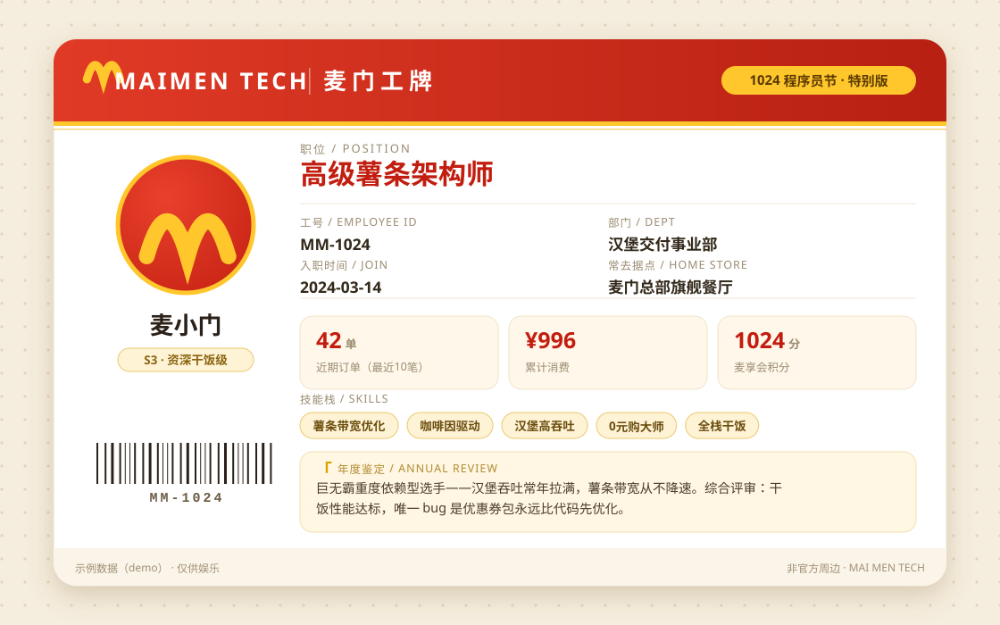

# 🍔 麦门工牌 · MCD BADGE

> 用麦当劳官方 MCP 读取你的真实订单，AI 给你发一张「麦门程序员工牌」。
> 职位不是你选的，是你**吃**出来的。



## 这是什么

1024 程序员节，麦当劳开放了官方 MCP（open.mcd.cn）。本技能把你的真实消费数据蒸馏成一张可晒的工牌卡片：

| 工牌字段 | 来源 |
|---|---|
| 职位（如「早八薅羊毛架构师」） | 点餐行为推导：0 元单、时段分布、常点品类 |
| 技能栈（咖啡因驱动 / 薯条带宽优化…） | 常点单品关键词映射 |
| 工号 | 会员账号派生 |
| 部门 | 按常点品类推导（全球通用，不绑门店）：汉堡交付事业部 / 咖啡因动力研究所 / 薅羊毛特别行动组… |
| KPI 三格 | 近期订单数 / 累计消费 / 麦享会实时积分 |
| 年度鉴定 | AI 一句话毒舌点评（引用你的真实数据细节） |
| 条码 | 工号确定性生成，纯装饰 |

卡片为纯 SVG 矢量渲染（零依赖），HTML 版点一下按钮就能存 2x 高清 PNG，直接发社交平台。

## 其实是五合一全家桶

| 玩法 | 一句话 | 命令入口 |
|---|---|---|
| 🪪 麦门工牌 | 真实订单/积分 → 程序员工牌卡片 | `collect-stats.mjs` + `make-badge.mjs` |
| 🍟 麦门团餐规划 | 人数+预算+忌口 → 配餐+真实试算 | `plan-feast.mjs stores/menu/price` |
| 🎂 麦麦派对策划师 | 生日派对/品鉴会的城市→门店→场次 | `mcd-extras.mjs party-*` |
| ⏰ 积分过期军师 | 快过期积分 → 最优兑换建议 | `mcd-extras.mjs points / mall` |
| 📡 麦门情报站 | 活动日历 + 可领券清单 | `mcd-extras.mjs intel` |

团餐示例（其余玩法见 SKILL.md，全部只读、不下单）：

```bash
node scripts/plan-feast.mjs stores --city 上海 --keyword 龙阳路 --beType 1 --searchType 2
node scripts/plan-feast.mjs menu  --storeCode 1450105 --orderType 1 --beType 1
node scripts/plan-feast.mjs price --storeCode 1450105 --orderType 1 --beType 1 \
  --items '[{"productCode":"521741","quantity":2}]'
```

## 适合谁

- 麦门信徒：想拥有一张"官方盖章"级别的干饭身份凭证
- 打工人 / 学生：程序员节朋友圈晒图素材，晒的是自己真实吃出来的 KPI
- 组织聚餐/派对的干饭头子：团建、社团、生日会，报人数和预算就出方案
- 精打细算的积分玩家：过期预警 + 兑换建议，一分都不浪费
- Skill 开发者：想学**零依赖接入 Streamable HTTP MCP** 的，本仓库 scripts/ 就是现成参考实现（无任何 SDK）

## 快速开始

### 方式一：在 WorkBuddy 中使用（推荐）

1. 把本仓库克隆到本地，将整个文件夹复制到 WorkBuddy 技能目录（或按 WorkBuddy 技能安装方式导入）
2. 准备 Token（见下方「Token 申请」），写入项目根目录 `.token.local` 文件
3. 对 WorkBuddy 说：**「给我生成麦门工牌」** / **「帮我配一桌麦当劳团餐，6 个人人均 35」** / **「帮我策划一场生日派对」** / **「我积分快过期了」** / **「麦当劳最近有什么活动」**

五个玩法对应五个工作流，全部只读、不下单，详见 SKILL.md。

### 方式二：手动运行（Node ≥ 18，零 npm 依赖）

```bash
git clone https://github.com/<you>/mcd-badge.git
cd mcd-badge
echo "你的Token" > .token.local        # 别提交这个文件

node scripts/collect-stats.mjs --nickname 你的名字 --include-orders -o stats.json
node scripts/make-badge.mjs stats.json -o output/我的工牌
# 打开 output/我的工牌.html → 点「保存 PNG」
```

自检连通性：

```bash
node scripts/mcd.mjs ping      # MCP 握手 + 时间接口
node scripts/mcd.mjs tools     # 列出麦当劳 MCP 全部工具
```

## Token 申请

1. 打开 [open.mcd.cn](https://open.mcd.cn)，右上角【登录】（麦当劳会员扫码）
2. 右上角【控制台】→ 点【激活】→ 同意服务协议
3. 复制 Token，存入 `.token.local`（或环境变量 `MCD_MCP_TOKEN`）

> 限流：每 Token 每分钟 600 次请求，本技能只调 2~3 个只读接口，随便造。

## 隐私与安全

- 只调用**只读**接口：`order-list`（最近 10 笔订单）、`query-my-account`（积分）。不下单、不领券、不抽奖、不碰支付
- `output/`、`stats.json`、`.token.local` 均已加入 `.gitignore`，真实数据不出本机
- 工牌卡片含门店名，分享前请自行确认
- 仅供娱乐，粉丝二创作品，与麦当劳官方无关

## 仓库结构

```
mcd-badge/
├── SKILL.md                  # WorkBuddy 技能定义（技能本体）
├── MCP_INTEGRATION.md        # 麦当劳 MCP 接入说明（Server/Tool/调用流程/业务价值）
├── workbuddy.md              # WorkBuddy 开发对话记录（联动活动奖励凭证）
├── CONTEST_DECLARATION.md    # 参赛声明（官方原文）
├── scripts/
│   ├── mcp-client.mjs        # 麦当劳 MCP 公共客户端（Streamable HTTP，零依赖）
│   ├── mcd.mjs               # CLI：ping / tools / call <tool> <args>
│   ├── collect-stats.mjs     # 拉取订单+积分 → 计算职位/部门/技能/KPI → stats.json
│   ├── make-badge.mjs        # stats.json → 工牌 SVG + HTML（可存 PNG）
│   ├── plan-feast.mjs        # 团餐规划管道：查店 / 拉菜单 / 试算（不下单）
│   └── mcd-extras.mjs        # 派对策划 / 积分军师 / 情报站 管道（全部只读）
├── assets/demo-badge.svg     # 演示卡（示例数据，非真实个人数据）
└── README.md
```

## 技术要点

- 麦当劳 MCP 为 **Streamable HTTP** 传输，`Authorization: Bearer <TOKEN>` 认证；本仓库用 Node 原生 `fetch` 直接实现了 JSON-RPC 握手（initialize → notifications/initialized → tools/call），**不需要任何 MCP SDK**
- 服务端返回格式在 JSON 与 `text/event-stream` 之间浮动，客户端已做双格式兼容
- 工牌排版为游标式纵向布局，职位/技能条/鉴定文案长度自适应，不会溢出卡片

## 参赛信息

- 赛事：**麦当劳程序员创意开发大赛**（M-China × 腾讯 WorkBuddy，1024 程序员节）
- 开发方式：全程使用**腾讯 WorkBuddy** 开发（对话记录见 `docs/开发对话记录.md`）
- 规则详见：GitHub 搜索 `McDonald's China (M-China)` → mcd-developer-innovation-challenge

## License

MIT
